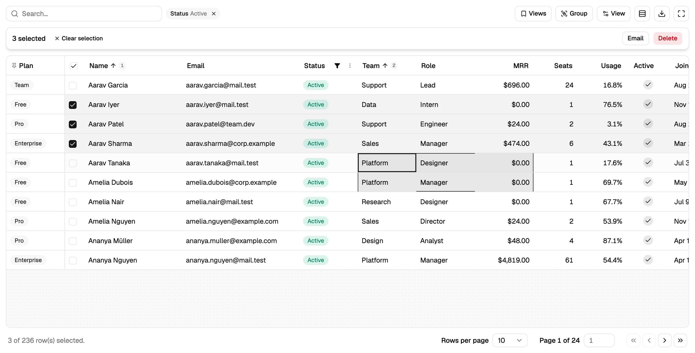

<h1 align="center">Kadal UI</h1>

<h3 align="center">Components you own.</h3>

<p align="center">
  Open-source React components for power users, starting with a data grid on TanStack Table v9
  and shadcn/ui. One command copies the source into your project. MIT.
</p>

<p align="center">
  <a href="https://www.npmjs.com/package/@kadal/ui"></a>
  <a href="https://www.npmjs.com/package/@kadal/ui"></a>
  <a href="https://github.com/kadalcc/ui/actions/workflows/ci.yml"></a>
  <a href="LICENSE"></a>
  <a href="https://ui.kadal.cc/r/registry.json"></a>
  <a href="https://github.com/sponsors/pmithunish"></a>
</p>

A data grid is where your users spend their day, and the one component every vendor sells you with
a licence key. Kadal UI's grid is MIT and it lives in your repository: sorting, faceted filters,
fuzzy search, grouping with aggregation, 50,000 virtualized rows, inline editing, spreadsheet-style
keyboard ranges and clipboard, export, saved views and URL state, typed from the row to the cell.
It is built on TanStack Table v9 and the Base UI flavour of shadcn/ui, and it is distributed as a
[shadcn registry](https://ui.shadcn.com/docs/registry), so you install it the way you install a
shadcn button and change it the way you change one.

```sh
npx shadcn@latest add @kadal/data-grid
```

<p align="center">
  <a href="https://ui.kadal.cc">
    
  </a>
</p>

<p align="center">
  <a href="https://ui.kadal.cc/docs/quick-start/"><strong>Your first grid in 5 minutes →</strong></a><br>
  <sub>Or try every feature in the <a href="https://ui.kadal.cc/playground/">playground</a>, no install.</sub>
</p>

<p align="center">
  <a href="https://ui.kadal.cc/docs/">Docs</a> ·
  <a href="https://ui.kadal.cc/docs/data-grid/">Data grid</a> ·
  <a href="https://ui.kadal.cc/docs/data-grid/api/">API</a> ·
  <a href="https://ui.kadal.cc/playground/">Playground</a> ·
  <a href="https://ui.kadal.cc/changelog/">Changelog</a> ·
  <a href="https://ui.kadal.cc/sponsor/">Sponsor</a>
</p>

---

## Start in 30 seconds

You need a React 19 project with Tailwind CSS v4 and shadcn/ui set up for Base UI
(`npx shadcn@latest init -b base`). Then:

```sh
npx shadcn@latest add @kadal/data-grid       # or: npx @kadal/ui add data-grid
```

That copies the grid's 21 TypeScript files into `components/ui/data-grid/`, adds the shadcn
primitives it uses, and installs TanStack Table, TanStack Virtual and dnd kit. No CSS to import:
it is Tailwind over your theme tokens, so it takes your colours and dark mode as they are.

```tsx
import { DataGrid, createDataGridColumns } from "@/components/ui/data-grid"

type Order = { id: string; customer: string; status: "paid" | "open" | "refunded"; total: number; placedAt: Date }

const col = createDataGridColumns<Order>()
const columns = col.columns([
  col.select(),
  col.text("customer", { header: "Customer", editable: true }),
  col.enum("status", { options: [{ value: "paid", label: "Paid" }, { value: "open", label: "Open" }, { value: "refunded", label: "Refunded" }] }),
  col.currency("total", { header: "Total", currency: "EUR" }),
  col.date("placedAt", { header: "Placed" }),
  col.actions(({ row }) => <OrderMenu order={row.original} />),
])

export function Orders({ orders }: { orders: Order[] }) {
  return (
    <DataGrid
      data={orders}
      columns={columns}
      getRowId={(o) => o.id}
      persist="orders"
      onCellEdit={({ row, columnId, value }) => save(row.id, columnId, value)}
      bulkActions={(rows) => <Button onClick={() => archive(rows)}>Archive {rows.length}</Button>}
    />
  )
}
```

## What's in the grid

| | |
| --- | --- |
| **Typed columns** ([docs](https://ui.kadal.cc/docs/data-grid/columns/)) | A builder per column kind (`text`, `number`, `currency`, `percent`, `date`, `datetime`, `boolean`, `enum`, `tags`, `link`, …) that checks keys against your row type and types `format`, `validate` and `onEdit` to the real value. Each kind brings its sort, filter, editor, aggregation and export format. |
| **Sorting** ([docs](https://ui.kadal.cc/docs/data-grid/sorting/)) | Click to sort, shift-click to add a key, numbered badges, a menu for the rest. |
| **Filtering** ([docs](https://ui.kadal.cc/docs/data-grid/filtering/)) | Facets with counts and search, text operators, number and date ranges, booleans; chips to clear; filter values that round-trip through URLs. |
| **Search** ([docs](https://ui.kadal.cc/docs/data-grid/search/)) | Fuzzy, ranked, across every data column, debounced. |
| **Pagination or 50,000 rows** ([docs](https://ui.kadal.cc/docs/data-grid/virtualization/)) | A pager with page size, go-to-page and counts, or virtualized rows with the sticky header and pinning intact. |
| **Selection and bulk actions** ([docs](https://ui.kadal.cc/docs/data-grid/selection/)) | Checkboxes, shift-click ranges, select all on the page, a bar for what happens next. |
| **Pin, reorder, resize, hide** ([docs](https://ui.kadal.cc/docs/data-grid/pinning/)) | Pin to either end (logical start/end, RTL-aware), drag headers, drag edges or double-click to fit, a searchable column list. |
| **Group and aggregate** ([docs](https://ui.kadal.cc/docs/data-grid/grouping/)) | Group by any column; sums, means, counts and ranges in group rows and footers, formatted like the column. |
| **Tree data** ([docs](https://ui.kadal.cc/docs/data-grid/expanding/)) | Nested rows with an expander column and selection that follows the tree. |
| **Inline editing** ([docs](https://ui.kadal.cc/docs/data-grid/editing/)) | Enter, F2 or double-click; text, number, select, checkbox, date and textarea editors; validation; Tab moves on. |
| **Keyboard and clipboard** ([docs](https://ui.kadal.cc/docs/data-grid/keyboard/)) | Arrow keys, Home/End, PageUp/Down, Shift to extend a range, ⌘A, ⌘C as tab-separated text that pastes into a spreadsheet. |
| **Export** ([docs](https://ui.kadal.cc/docs/data-grid/export/)) | CSV and JSON of what's on screen or the selection, values as displayed. |
| **Saved views and URL state** ([docs](https://ui.kadal.cc/docs/data-grid/persistence/)) | Columns, sort, sizes, pinning, order, grouping, density and page size remembered per user; named views; filters, search and page in the URL with nuqs. |
| **Server-side** ([docs](https://ui.kadal.cc/docs/data-grid/server-side/)) | Hand it a page and a row count; sort and filter state comes back for your query (a TanStack Query example included). |
| **States, density, row pinning** | Loading, error and empty states; compact/comfortable/spacious; rows pinned top or bottom. |
| **Accessible, translatable, composable** | A real `grid` with roles, `aria-sort`, roving focus and live announcements; every label a function you can replace; every part usable on its own. |

## Not a dependency. Your code.

The registry copies source, not a build. After `add`, the grid is yours: rename a label, swap an
icon, delete a feature, add a column kind. When a new version ships,
`npx shadcn@latest add @kadal/data-grid --diff` shows what changed, and `--overwrite` takes it.
Keep your own additions in files next to the grid and the overwrite stays painless.

What you get is current: React 19, TypeScript 7, Tailwind v4, shadcn/ui on Base UI (the default
since July 2026), TanStack Table v9 (tree-shaken features, store-based state, React Compiler safe).

## Registry

| Item | | Install |
| --- | --- | --- |
| `data-grid` | The grid: 21 files under `components/ui/data-grid/` | `npx shadcn@latest add @kadal/data-grid` |
| `data-grid-url-state` | Filters, search and page in the URL (nuqs) | `npx shadcn@latest add @kadal/data-grid-url-state` |
| `data-grid-demo-data` | The seeded demo rows the docs use | `npx shadcn@latest add @kadal/data-grid-demo-data` |
| `data-grid-demo`, `-basic`, `-virtualized`, `-tree`, `-server`, `-composed`, `-url-state-example` | The examples from the docs, as files | `npx shadcn@latest add @kadal/data-grid-demo` |

Register the namespace once in `components.json` (`"registries": { "@kadal": "https://ui.kadal.cc/r/{name}.json" }`),
or let the CLI do it. Without a namespace: `npx shadcn@latest add kadalcc/ui/data-grid` installs
straight from this repository. The registry is static JSON at
[ui.kadal.cc/r/registry.json](https://ui.kadal.cc/r/registry.json).

## The CLI

[`@kadal/ui`](https://www.npmjs.com/package/@kadal/ui) is a small, dependency-free wrapper around
the shadcn CLI that knows this registry:

```sh
npx @kadal/ui add data-grid          # registers @kadal and adds the item (runs shadcn init -b base if needed)
npx @kadal/ui list                   # what's in the registry
npx @kadal/ui diff data-grid         # what changed upstream since your copy
npx @kadal/ui docs data-grid --open  # the docs page
npx @kadal/ui mcp --client claude    # the shadcn MCP server, configured for this registry
```

## For AI agents

An [Agent Skill](skills/kadal-ui/SKILL.md) teaches Claude Code, Cursor or any skills-aware agent to
add the grid to a project and write columns for it; `npx skills add kadalcc/ui` installs it, and
the repository is a Claude Code plugin marketplace (`/plugin marketplace add kadalcc/ui`). The
[shadcn MCP server](https://ui.shadcn.com/docs/mcp) serves this registry to any MCP client once
the namespace is in `components.json` (`npx @kadal/ui mcp`). The docs are also at
[ui.kadal.cc/llms.txt](https://ui.kadal.cc/llms.txt).

## Documentation

[Installation](https://ui.kadal.cc/docs/installation/) ·
[Quick start](https://ui.kadal.cc/docs/quick-start/) ·
[Type safety](https://ui.kadal.cc/docs/type-safety/) ·
[Theming](https://ui.kadal.cc/docs/theming/) ·
[Every feature](https://ui.kadal.cc/docs/data-grid/) ·
[API reference](https://ui.kadal.cc/docs/data-grid/api/) ·
[CLI](https://ui.kadal.cc/docs/cli/) ·
[Compared with other grids](https://ui.kadal.cc/docs/compare/) ·
[FAQ](https://ui.kadal.cc/docs/faq/)

## Repository

| path | |
| --- | --- |
| [`apps/www/registry/kadal/ui/data-grid`](apps/www/registry/kadal/ui/data-grid) | the grid's source, the files the registry serves |
| [`apps/www/registry/kadal/examples`](apps/www/registry/kadal/examples) | the examples on every docs page |
| [`apps/www/registry.json`](apps/www/registry.json) | the registry manifest; `shadcn build` writes `apps/www/public/r` |
| [`apps/www`](apps/www) | ui.kadal.cc: landing, docs (Astro + Starlight), playground (LiveCodes) |
| [`packages/cli`](packages/cli) | `@kadal/ui` on npm |
| [`skills/kadal-ui`](skills/kadal-ui) | the Agent Skill |

`bun install`, `bun run dev` (the site, with every example live), `bun run typecheck`, `bun run test`,
`bun run test:e2e` (Playwright on Chromium, Firefox and WebKit), `bun run build`.
[CONTRIBUTING.md](CONTRIBUTING.md) has the rest.

## Licence

[MIT](LICENSE). Use it in anything, including closed-source products; keep the notice. The docs
text is CC BY 4.0.

## Contributing

A bug report with a [playground](https://ui.kadal.cc/playground/) link that reproduces it is the
most useful thing you can send, and pull requests are welcome. Questions go to
[Discussions](https://github.com/kadalcc/ui/discussions) or the
[Kadal Discord](https://discord.gg/pdWcSbxNKa); ideas to
[a feature request](https://github.com/kadalcc/ui/issues/new?template=feature.yml); anything else
to [feedback](https://github.com/kadalcc/ui/discussions/new?category=general). Please follow the
[code of conduct](CODE_OF_CONDUCT.md), and report security issues privately as
[SECURITY.md](SECURITY.md) describes.

## Sponsors

There is no paid tier of Kadal UI. Sponsorships pay for time on issues, docs, new components and
the features you ask for. **[Sponsor Kadal UI on GitHub](https://github.com/sponsors/pmithunish)**;
the tiers and what each one gets are on [ui.kadal.cc/sponsor](https://ui.kadal.cc/sponsor/), and
backers are listed in [BACKERS.md](BACKERS.md). Companies can sponsor
[by invoice](https://docs.github.com/en/sponsors/sponsoring-open-source-contributors/paying-for-github-sponsors-by-invoice).

<!-- sponsors: Gold, Silver and Bronze logos and Patron avatars go here, largest first -->
<p align="center">
  <a href="https://github.com/sponsors/pmithunish"><strong>Your logo here</strong></a>:
  be the first company to sponsor Kadal UI.
</p>
<!-- /sponsors -->

## More from Kadal

The paid products that also fund this work:

- **[Kadal Deck](https://deck.kadal.cc/?ref=ui)**, the AI presentation app: make slides with AI,
  rehearse them, present them live while the room follows on their phones. Its engine is open source
  too ([kadalcc/deck](https://github.com/kadalcc/deck)).
- **[Kadal Store](https://store.kadal.cc/?ref=ui)**: printable planners, music, sound effects,
  shaders and 3D. Pay once, keep the files.
- Need a team that builds AI products end to end? **[work.kadal.cc](https://work.kadal.cc)**.

<p align="center">
  <sub>Made in Chennai by <a href="https://kadal.cc">Kadal</a> · <a href="https://ui.kadal.cc">ui.kadal.cc</a> · <a href="mailto:hello@kadal.cc">hello@kadal.cc</a></sub>
</p>
